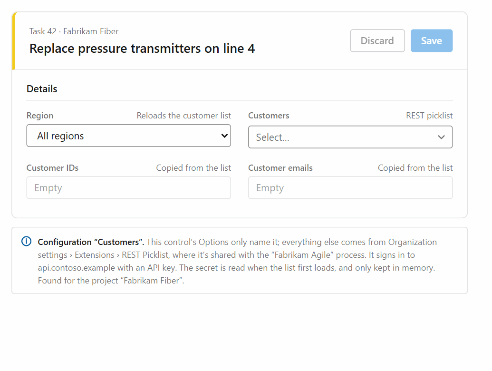
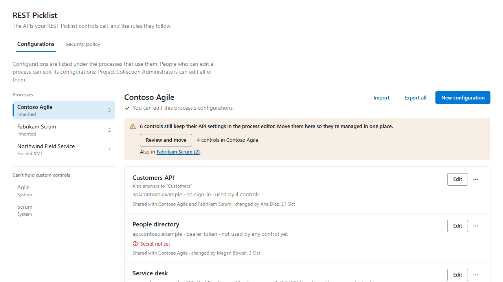
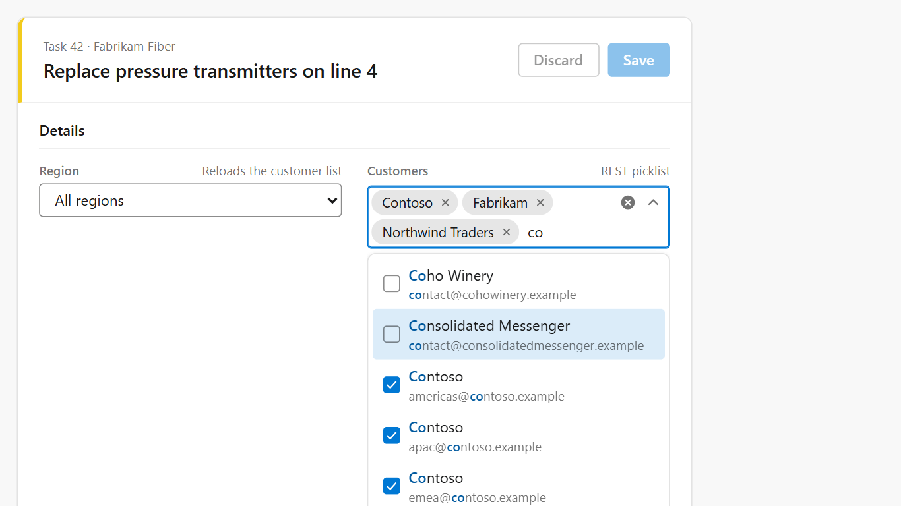
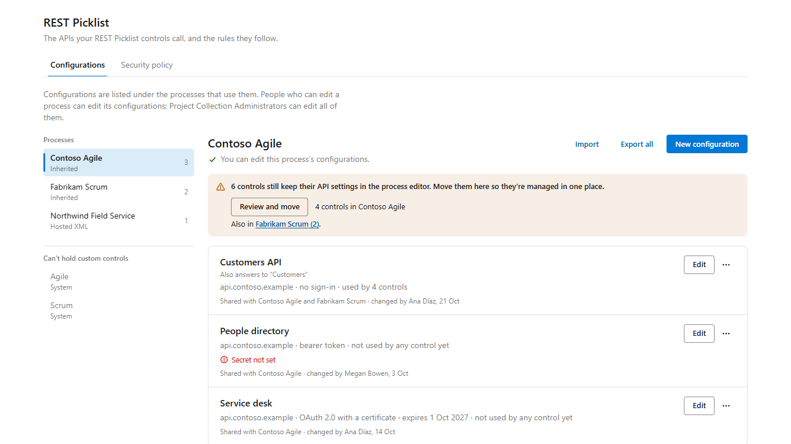
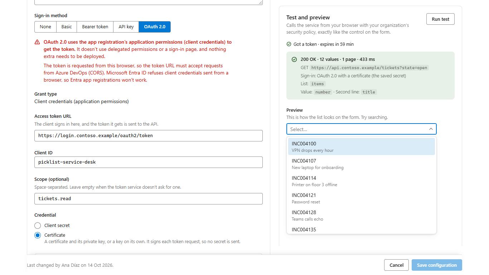
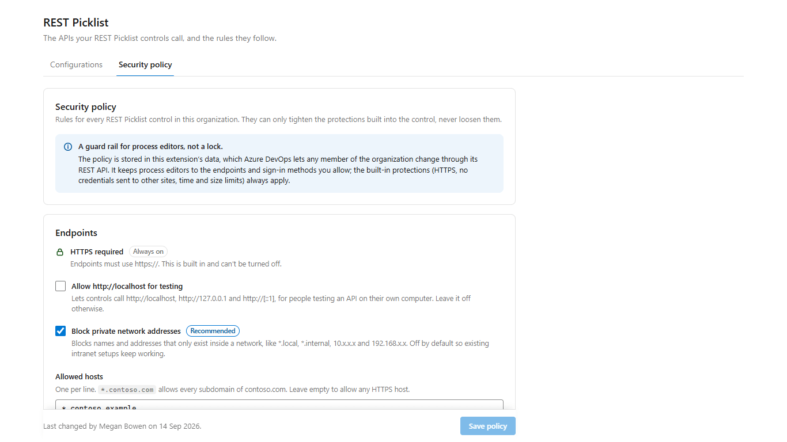

# REST Data Mapping Picklist

#### An Azure DevOps work item form extension

A work item control that loads its values from a REST API, with search, multiple values, paging and mapping of extra data into other fields. Its API settings live in configurations under **Organization settings › Extensions › REST Picklist**, grouped by the processes that use them, with write-only credentials and OAuth 2.0 client credentials (a client secret or a certificate). The same page sets the organization’s security policy and moves controls set up with earlier versions.

https://marketplace.visualstudio.com/items?itemName=OscarArguedasBarboza.RestDataMappingPicklist





| The control on a work item form                                              | The Configurations tab                                                                                                            |
| ---------------------------------------------------------------------------- | --------------------------------------------------------------------------------------------------------------------------------- |
|  |  |

| The configuration editor                                                                                         | The Security policy tab                                                                      |
| ---------------------------------------------------------------------------------------------------------------- | -------------------------------------------------------------------------------------------- |
|  |  |

User documentation is in [overview.md](overview.md), which is also the Marketplace page. The images come from the local playground and the setup page’s demo mode (`npm run playground`).

## How it fits together

- **The control** (`dist/selector.html`, contribution `rest-data-mapping-picklist`) runs in an iframe on the work item form. Its Options tab has two inputs, `FieldName` and `Configuration`. When the work item opens, it finds the project’s process and the configuration with that name shared with it. When the list opens (or with the form, if the configuration says so), it reads the security policy and, when the configuration signs in, its credential, gets an OAuth 2.0 token if needed, and calls the API from the browser.
- **Older controls** that still have 3.0 inputs on their Options tab (`hasLegacySettings`) run as in 3.0: their own settings, 3.0 saved configurations found in the process layout, and their own password.
- **A control with neither** calls no API and shows “API configuration has moved. You can find it under Organization settings › Extensions › REST Picklist, or click here.”, linking to `{organization}/_settings/{publisher}.{extension}.rest-picklist-setup` through the host navigation service.
- **The setup page** (`dist/configurator.html`, hub `rest-picklist-setup` in `ms.vss-web.collection-admin-hub-group`) is Organization settings › Extensions › REST Picklist. The **Configurations** tab lists processes, their configurations and the REST Picklist controls on their forms, opens the configuration editor, and moves older controls. The **Security policy** tab sets the organization’s rules. The page checks the signed-in person’s permissions with one `permissionevaluationbatch` call and applies the edit rules in its UI. If Azure DevOps refuses that call (401 or 403), editing isn’t limited, so Project Collection Administrators aren’t locked out; if it fails for another reason, the page is view-only until it works.
- **Storage** is extension data and process layouts: see [Data and storage](#data-and-storage).

## OAuth 2.0

OAuth 2.0 is the client credentials grant only (application permissions), requested from the browser the way Postman does it. There are no delegated permissions, no sign-in page or popup, and no token service to deploy. Whenever OAuth 2.0 is the selected sign-in method, the setup page shows this notice in red text, directly under the method. Its words are a product decision, so keep them as they are (`OAUTH_NOTICE` in `src/configurator/OAuthFields.tsx`):

> [!CAUTION]
> **OAuth 2.0 uses the app registration’s application permissions (client credentials) to get the token.** It doesn’t use delegated permissions or a sign-in page, and nothing extra needs to be deployed.
>
> The token is requested from this browser, so the token URL must accept requests from Azure DevOps (CORS). Microsoft Entra ID refuses client credentials sent from a browser, so Entra app registrations won’t work.

- Client authentication: the client secret in a Basic header (`client_secret_basic`, the default) or in the body (`client_secret_post`), or a JWT signed with a private key (`private_key_jwt`, RFC 7523), from a certificate or from a key alone.
- `src/core/oauth.ts` builds and sends the token request (`credentials: 'omit'`, `redirect: 'error'`, `cache: 'no-store'`, the configuration’s timeout), signs client assertions with WebCrypto (RS, PS and ES with SHA-256, 384 or 512), checks the response, removes sent secrets from error text, and keeps tokens in memory (`sharedTokenCache`) until a minute before they expire. The control loads it only for configurations that use OAuth 2.0, and gets a new token and retries once when the API answers 401.
- `src/core/certificates.ts`, with `asn1`, `pbe`, `legacyCiphers`, `privateKeys`, `x509`, `pkcs12` and `sha`, reads PEM, DER and PKCS #12 files in the browser. Only the setup page uses it, loaded when a file is chosen.
- Microsoft Entra ID refuses client credentials in any request that has an `Origin` header. `isMicrosoftEntraTokenUrl` recognizes Entra hosts in every cloud, plus `*.ciamlogin.com` and `*.b2clogin.com`: the editor shows an error under the token URL and blocks Save, and the control explains the failure.
- Not supported: authorization code (with or without PKCE), device code, the password grant, `client_secret_jwt`, mutual TLS and refresh tokens.

## Requirements

- Node.js 26 (see `.nvmrc`; `package.json` accepts 24.15 or later) and npm 11
- OpenSSL 3, only to regenerate the test keys and certificates (`src/core/__fixtures__/generate-credentials.mjs`)

## Develop

```sh
npm ci
npm run playground   # http://localhost:3000/dist/playground.html
```

**The playground** simulates a work item form with a mock REST service and a mock token endpoint, so you can try every state without deploying: themes, lazy or preloaded lists, required, read-only, slow or failing networks, large and paged lists, and phone width. **Set up with** chooses where the control’s settings come from:

| Choice                  | URL                               | What it shows                                                                                     |
| ----------------------- | --------------------------------- | ------------------------------------------------------------------------------------------------- |
| Configuration           | `?source=configuration` (default) | A control that names the configuration “Customers”, which signs in with an API key                |
| OAuth 2.0               | `?source=oauth`                   | A configuration that gets a token from the mock token endpoint with a client secret, then uses it |
| Settings on the control | `?source=legacy`                  | A control set up before 4.0, with everything on its Options tab                                   |
| No configuration        | `?source=moved`                   | The “API configuration has moved” message and its link                                            |

Every switch is kept in the URL, so a scenario can be bookmarked: for example `?nosecret=1` (the secret was never set), `?name=Customer%20list` (a former name) or `?name=Contacts` (no such configuration), `?theme=dark`, `?network=slow`, `?multi=1`, `?paging=1`, and `?clean=1` for only the form card, for screenshots.

**The setup page** runs on the same server at `http://localhost:3000/dist/configurator.html`. Outside Azure DevOps it uses in-memory demo services (`src/configurator/demoServices.ts`):

- Two system processes, two inherited processes and a Hosted XML one.
- Configurations shared by two processes, signing in with OAuth 2.0 and a certificate, with a missing secret, with a certificate that expires soon, with an API key, and one not used by any process.
- Controls in every state, including 3.0 controls to move, with readable and masked passwords.
- A sample API at `https://api.contoso.example` and a token service at `https://login.contoso.example`, both answered inside the page.
- **Signed in as** switches between a Project Collection Administrator, an editor of Contoso Agile only, a viewer without Edit process permission, someone whose permission check fails, and someone whose permission check is refused.

Nothing is saved anywhere: reload to start over. Production builds leave the demo out.

| Command                                  | What it does                                                                           |
| ---------------------------------------- | -------------------------------------------------------------------------------------- |
| `npm run verify`                         | Type-check (TypeScript 7), lint (oxlint, type-aware) and unit tests (Vitest)           |
| `npm test`, `npm run test:watch`         | Unit tests, once or on every change                                                    |
| `npm run typecheck`, `npm run lint`      | One check at a time                                                                    |
| `npm run format`, `npm run format:check` | Prettier, which also reads `.editorconfig` (CRLF line endings)                         |
| `npm run build-dev`, `npm run watch`     | Development build in `dist/`, once or on every change                                  |
| `npm run serve-dev`                      | Serves the development build at `https://localhost:44300`, for the dev extension below |
| `npm run build`                          | Type-check, production build and `.vsix` package                                       |
| `npm run clean`                          | Removes `dist/` and packaged `.vsix` files                                             |

## Test

Tests live next to the code (`src/**/*.test.ts(x)`). Component tests opt into jsdom with a `/** @vitest-environment jsdom */` comment and mock `azure-devops-extension-sdk` the way the existing tests do. No test calls the network. Crypto tests use Node’s WebCrypto. The keys and certificates in `src/core/__fixtures__/credentials.ts` are throwaway test credentials made by `generate-credentials.mjs` with OpenSSL; each run makes new ones, and the tests read every expected value from the fixtures.

CI runs `npm ci`, `npm run verify` and `npm run build` on every push and pull request to `main`. CodeQL scans `src` on the same events and once a week, and Dependabot proposes npm updates once a month.

## Build, package and release

```sh
npm run build        # type-checks, builds for production and creates the .vsix
```

1. Update `version` in `package.json`, `azure-devops-extension.json` and `azure-devops-extension-dev.json`, keeping all three the same.
1. Run `npm run build`. It writes the production build to `dist/` and packages it with `tfx` into a `.vsix`.
1. Upload the `.vsix` to the Marketplace, or run `npm run gallery-publish` with a valid token.

- A release that adds scopes needs every organization’s administrator to approve them before the update installs, so call that out in the release notes. 4.0 asks for the same scopes as 3.0.
- 4.0 changes the control’s Options tab to `FieldName` and `Configuration`. Point the release notes to “Moving from 3.x” in [overview.md](overview.md#moving-from-3x).
- When a package that ships in the extension changes version (React, React DOM, scheduler, the Azure DevOps extension SDK), update [THIRD-PARTY-NOTICES.md](THIRD-PARTY-NOTICES.md) with its version and license text from `node_modules`.

### Bundles

Each page has its own script and stylesheet, plus a shared `vendor` chunk with React and the SDK.

- The control’s startup script stays small. `src/control/**` must not import `src/configurator/**`, the certificate code (`asn1`, `pbe`, `legacyCiphers`, `privateKeys`, `x509`, `pkcs12`, `certificates`, `sha`), `core/migration.ts` or `devops/permissions.ts`.
- Azure DevOps calls (`configurationStore`, `policyStore`, `layout` and `savedConfigurations`, `navigation`) and `core/oauth.ts` are lazy chunks, and modules they share go into one `lazy-shared` chunk.
- `webpack.config.js` warns when a file the control loads at startup grows past 250 KB, or all of them past 350 KB (minified). The setup page isn’t held to these budgets.
- Production pages carry a Content Security Policy: scripts from the extension only, and connections to any HTTPS address, plus localhost for testing.

### Marketplace listing

The manifest carries what Microsoft asks of a public listing: a 128×128 or larger icon (`img/Logo.png`), a short description (under 200 characters), `overview.md` as the details page with the two GIFs, four 1366×768 screenshots in `img/screenshots/` (`control.png`, `setup-configurations.png`, `setup-editor.png` and `setup-policy.png`), branding colors, tags, the license (`LICENSE`, shown as the License tab), and links to get started, learn more, support, privacy policy, license, repository and issues. The package also ships [THIRD-PARTY-NOTICES.md](THIRD-PARTY-NOTICES.md). The linked policies are [SUPPORT.md](SUPPORT.md), [PRIVACY.md](PRIVACY.md) and [SECURITY.md](SECURITY.md). The links point to `main` on https://github.com/OscarArguedasB/RestDataMappingPicklist, so push these files before publishing. When the UI changes, retake the GIFs and screenshots from the playground and the setup page’s demo mode.

## Try it in a real organization

`azure-devops-extension-dev.json` overrides the manifest for a private development extension (`RestDataMappingPicklistDev`) that loads its pages from `https://localhost:44300`.

1. Build and package the dev extension:
   ```sh
   npm run build-dev
   npm run package-dev
   ```
1. Upload the package to the Marketplace under your publisher, share it with a test organization and install it there. Increase `version` in `azure-devops-extension-dev.json` for each new upload.
1. Run the dev server and open `https://localhost:44300/dist/selector.html` once to accept the local certificate:
   ```sh
   npm run serve-dev
   ```
1. Open **Organization settings › Extensions › REST Picklist** (the dev extension’s page) and create a configuration for an inherited process. Add the control to a work item type of that process, and enter the configuration’s name in **Configuration name**.

Things to know about the dev extension:

- It has its own extension data. Its configurations, credentials and security policy are separate from the published extension’s, and its controls only find configurations made on its own page, which its links open.
- Controls are recognized by the contribution id ending `.rest-data-mapping-picklist`, so the dev page also lists the published extension’s controls in the same process, and both see each other’s 3.0 saved configurations. Don’t assign or move the published extension’s controls from the dev page: they would name a configuration that only exists in the dev extension’s data.
- The APIs and token services you test with must allow `https://localhost:44300` (CORS).

## Verify in a real organization

These can’t be tested offline. Check them in a test organization before each release, and record what you find in this list.

**The Options tab and older controls**

- [ ] **Options tab.** The process editor shows only **Field to fill in** and **Configuration name**, and the long Configuration label (“Configuration name. ⚠ API configuration has moved: …”) and its description read well.
- [ ] **Older controls keep their inputs.** After updating from 3.0, `SDK.getConfiguration().witInputs` of a control set up with 3.0, and of one from 1.x, still contains its old inputs, so it keeps working: its own settings, a 3.0 saved configuration, and its password or token, including `Bearer` in the user name. If Azure DevOps drops inputs the manifest no longer declares, those controls show the moved message instead: record it and update overview.md.
- [ ] **Saving an older control in the process editor.** Open one, save it without changes, and check whether its old inputs survive. overview.md tells people to move controls first.

**Permissions**

- [ ] **Permission check.** `POST _apis/security/permissionevaluationbatch?api-version=7.1` works with the extension’s token for a Project Collection Administrator, a process editor and a Contributor, and gives the right answers. The process token `$PROCESS:{parentProcessTypeId}:{processTypeId}:` is right (the page also asks without the trailing colon). If the call is refused (401 or 403), the page says “Couldn’t verify your permissions (…), so editing isn’t limited here.” and lets everyone edit; other failures say “Couldn’t check your permissions (…)” and make the page view-only. Record which one happens, for which roles, and the status.
- [ ] **Many processes.** The single request, with 2N+1 evaluations, works in an organization with many processes.

**The settings page**

- [ ] **Links from the form.** “click here” and “Open REST Picklist settings” open Organization settings › Extensions › REST Picklist (`{organization}/_settings/{publisher}.{extension}.rest-picklist-setup`) in a new tab, through `openNewWindow` of `ms.vss-features.host-navigation-service` called from the work item form’s frame. The hub shows there as **REST Picklist**, and looking up the organization’s address makes no extra REST request.

**Extension data**

- [ ] **Documents.** Creating, updating (with `__etag`), deleting and listing configurations work, and listing before anything was saved gives an empty list. Two tabs saving the same configuration get “Someone changed “X” since you opened it. Reload to see their changes.” Record the error shapes Azure DevOps returns (`DocumentCollectionDoesNotExist`, `DocumentDoesNotExist`, `InvalidDocumentVersion`, `DocumentExists` and their status codes), which `configurationStore.ts` maps to 404 and 409.
- [ ] **Reads for every role.** A configured control loads for a Contributor and for a Stakeholder: it reads `_apis/work/processes?$expand=projects`, the `configurations` collection and the configuration’s `secrets` document with their token.
- [ ] **Security policy.** An administrator saves the policy, a member’s form reads it (key `securityPolicy`), and the page shows who changed it last. A version-1 policy saved by 3.0 with all four sign-in methods also allows OAuth 2.0.

**Process layouts**

- [ ] **Controls - Update.** Assigning, moving and cleaning up send exactly `{ FieldName, Configuration }`. Afterwards the layout has no other inputs and no password, and the control keeps its label, visibility and position.
- [ ] **Passwords in layouts.** Record what `…/workitemtypes?$expand=layout` returns for `RestServicePassword`, a confidential input, to an administrator and to a process editor: masked, missing or in clear text. Moving only copies values that aren’t masked.
- [ ] **Hosted XML processes.** Reading and updating their controls through the inherited-process layout API works, or fails for that process only, with **Try again**.

**OAuth 2.0**

- [ ] **A CORS-enabled token service**, for example Keycloak: a client secret sent as a Basic header and in the body, and a certificate (private key JWT), both from the setup page’s test and from a work item form. In Basic mode, try a client secret with `+`, `/`, `=` or `%`.
- [ ] **PS256.** WebCrypto imports an `rsaEncryption` PKCS #8 key as RSA-PSS in Edge, Chrome, Firefox and Safari.
- [ ] **No false redirects.** Browsers report `response.url` equal to the token URL without its fragment, so a normal answer isn’t taken for a redirect.
- [ ] **401 retry.** When the API answers 401, the control gets a new token and retries once.
- [ ] **Microsoft Entra ID** fails with the documented messages: on the setup page (the error under the token URL, Save blocked, the test’s message) and on a form.

**Certificates in real browsers**

- [ ] `.pfx` files exported by Windows (Triple DES and AES), the macOS Keychain and Java `keytool` open with their password, in reasonable time.
- [ ] Firefox and Safari import an EC key without its public point, alone and with its certificate. Firefox opens an empty-password PFX that uses PBES2.
- [ ] Chrome and Edge show the `openssl` conversion command for an AES-192-encrypted key.

**Look and feel**

- [ ] **Themes.** The setup page and the control in Azure DevOps’ light, dark and high contrast themes: the red OAuth 2.0 notice stays readable, focus rings show, and every status has an icon and words. Local screenshots only emulate the dark and high contrast colors.
- [ ] **The editor in the hub frame.** The sticky test column (1100 px and wider), the sticky footer, and the sign-in methods turning into a radio list under 560 px.

**Updates and addresses**

- [ ] **Caching.** After a configuration is saved, a form in another tab uses the change within five minutes, and a newly set secret works on the next load.
- [ ] **Scopes.** Updating from 3.0 asks for no new scope. Updating from 1.x asks an administrator to approve `vso.extension.data_write`.
- [ ] **Legacy organization URLs.** Everything above in an organization reached at `https://{org}.visualstudio.com`, including the settings page link.

## Project layout

| Path               | Contents                                                                                                                                                       |
| ------------------ | -------------------------------------------------------------------------------------------------------------------------------------------------------------- |
| `src/core`         | Framework-free logic, with no React or SDK code (see below)                                                                                                    |
| `src/devops`       | Azure DevOps services: REST client, processes, permissions, process layouts, configurations and credentials, the security policy, navigation, the form service |
| `src/control`      | The work item form control: SDK wiring, and the controller that finds the configuration and keeps the field, list and form in sync                             |
| `src/components`   | The accessible, virtualized combobox (single and multiple values) shared by the control and the setup page’s preview                                           |
| `src/configurator` | The setup page: the Configurations and Security policy tabs, the configuration editor, its dialogs, and demo services for local development                    |
| `src/playground`   | Local development page with a mocked form, REST service and token endpoint (not shipped)                                                                       |
| `src/styles`       | Theme tokens mapped to Azure DevOps theme variables, and page styles                                                                                           |
| `scripts`          | `clean.mjs`                                                                                                                                                    |

The main modules:

| Module                                                                                                                                                                                                | Contents                                                                                                                                                                                                             |
| ----------------------------------------------------------------------------------------------------------------------------------------------------------------------------------------------------- | -------------------------------------------------------------------------------------------------------------------------------------------------------------------------------------------------------------------- |
| `src/core/config.ts`                                                                                                                                                                                  | Input ids, the settings a configuration keeps (`CONFIGURATION_SETTING_IDS`), sign-in methods, OAuth 2.0 and advanced settings, where a secret may be sent (`secretDestinationOrigin`), limits                        |
| `src/core/configurations.ts`                                                                                                                                                                          | The configuration document, name rules (unique per process, former names), the permission rules, finding a configuration for a process, and configuration files (version 2, reads version 1)                         |
| `src/core/secrets.ts`                                                                                                                                                                                 | Credential kinds, the secret document, the summary a configuration keeps, and the origin a secret is bound to                                                                                                        |
| `src/core/oauth.ts`                                                                                                                                                                                   | OAuth 2.0 client credentials: the token request, client assertions, response checks, Entra detection and the in-memory token cache                                                                                   |
| `src/core/certificates.ts`, with `asn1.ts`, `pbe.ts`, `legacyCiphers.ts`, `privateKeys.ts`, `x509.ts`, `pkcs12.ts` and `sha.ts`                                                                       | Reads PEM, DER and PKCS #12 keys and certificates for private key JWT (setup page only)                                                                                                                              |
| `src/core/migration.ts`                                                                                                                                                                               | Each control’s status in a layout, and the plan that moves older controls into configurations (setup page only)                                                                                                      |
| `src/core/request.ts`                                                                                                                                                                                 | Endpoint checks, `$(Field)` substitution, sign-in headers, and fetching with no cookies, a timeout, and no redirects when signing in or when the policy restricts hosts                                              |
| `src/core/policy.ts`                                                                                                                                                                                  | The security policy (version 2): parsing, host patterns, private addresses, endpoint, token URL and sign-in checks, limits                                                                                           |
| `src/core/paging.ts`                                                                                                                                                                                  | Loads every page: next link, page number, offset or cursor, within the item and page limits                                                                                                                          |
| `src/core/detect.ts`, `inspect.ts`                                                                                                                                                                    | Finds the list in a response and ranks value and second-line properties                                                                                                                                              |
| `src/core/items.ts`, `multi.ts`, `fieldTypes.ts`, `fieldMap.ts`                                                                                                                                       | Picklist items with second lines, multiple values (`A; B; C`), which fields the control can fill, and copying to other fields                                                                                        |
| `src/core/tokens.ts`, `search.ts`, `path.ts`, `cache.ts`, `responseBody.ts`, `errors.ts`, `values.ts`                                                                                                 | `$(Field)` tokens, accent-insensitive search, JSON paths, the response cache, reading answers with a size limit, `PicklistError`, and helpers that read untrusted values                                             |
| `src/devops/rest.ts`                                                                                                                                                                                  | Calls the organization’s REST API as the signed-in user                                                                                                                                                              |
| `src/devops/processes.ts`                                                                                                                                                                             | Lists processes and finds a project’s process, with a five-minute cache                                                                                                                                              |
| `src/devops/permissions.ts`                                                                                                                                                                           | One `permissionevaluationbatch` call: Project Collection Administrator, and Edit process on each process. Never throws: a refusal leaves editing unlimited, other failures make the page view-only (setup page only) |
| `src/devops/configurationStore.ts`                                                                                                                                                                    | Configurations and credentials in extension data: list, save with `__etag`, delete, secrets, and `resolveConfiguration` for the form                                                                                 |
| `src/devops/layout.ts`                                                                                                                                                                                | Finds REST Picklist controls in process layouts and updates their inputs (`Controls - Update`)                                                                                                                       |
| `src/devops/savedConfigurations.ts`                                                                                                                                                                   | The 3.0 runtime that older controls still use: saved configurations from process layouts                                                                                                                             |
| `src/devops/policyStore.ts`, `extensionData.ts`                                                                                                                                                       | The security policy in extension data, document helpers, and the five-minute session cache                                                                                                                           |
| `src/devops/navigation.ts`                                                                                                                                                                            | The setup page’s address, and opening it from a form                                                                                                                                                                 |
| `src/control/controller.ts`                                                                                                                                                                           | Configured, older and moved controls, credentials, tokens and the 401 retry, and the field, list and form state                                                                                                      |
| `src/control/host.ts`, `ControlApp.tsx`                                                                                                                                                               | The control’s Azure DevOps wiring, with lazy imports, and its view                                                                                                                                                   |
| `src/configurator/ConfiguratorApp.tsx`, `routes.ts`                                                                                                                                                   | The page: tabs, the address in the URL hash, loading data and permissions                                                                                                                                            |
| `src/configurator/ConfigurationsTab.tsx`, `ProcessList.tsx`, `ConfigurationList.tsx`, `ControlsSection.tsx`, `configurationStatus.ts`, `useProcessScans.ts`                                           | The Configurations tab: processes, configurations with their status, and the controls on each process’s forms                                                                                                        |
| `src/configurator/ConfigurationEditor.tsx`, `BuildTab.tsx`, `ConnectCard.tsx`, `OAuthFields.tsx`, `CredentialsCard.tsx`, `ValuesCard.tsx`, `OptionalSections.tsx`, `UseOnFormCard.tsx`, `settings.ts` | The configuration editor, its cards and its validation                                                                                                                                                               |
| `src/configurator/TestPanel.tsx`, `probe.ts`                                                                                                                                                          | The test and the live preview, with the same request, policy checks and token as the control                                                                                                                         |
| `src/configurator/MigrationDialog.tsx`, `migrationRun.ts`, `ShareDialog.tsx`, `ImportDialog.tsx`, `RenameControlsDialog.tsx`, `ConfirmDialog.tsx`                                                     | Moving controls, sharing, importing, updating controls after a rename, and confirmations                                                                                                                             |
| `src/configurator/PolicyTab.tsx`, `policyForm.ts`                                                                                                                                                     | The Security policy tab                                                                                                                                                                                              |
| `src/configurator/services.ts`, `devopsServices.ts`, `demoServices.ts`                                                                                                                                | What the page needs from Azure DevOps, and the in-memory demo                                                                                                                                                        |

## Data and storage

| What             | Where                                                                  | Notes                                                                                                                                                                                                                                                                                       |
| ---------------- | ---------------------------------------------------------------------- | ------------------------------------------------------------------------------------------------------------------------------------------------------------------------------------------------------------------------------------------------------------------------------------------- |
| Configurations   | Extension data, collection scope, collection `configurations`          | One document per configuration, with a random UUID as its id: name, up to five former names (`aliases`), `processIds`, `settings` keyed by the 3.0 input ids (strings; flags are `"true"`), the credential’s summary (kind, bound origin, certificate details), and who changed it and when |
| Credentials      | Collection `secrets`, document id = configuration id                   | `{ kind, value }`, or `{ kind: "signingKey", key }` with a PKCS #8 key, plus `boundOrigin`. Last write wins; never cached, logged or exported                                                                                                                                               |
| Security policy  | Value `securityPolicy`                                                 | Version 2                                                                                                                                                                                                                                                                                   |
| Control inputs   | Process layouts                                                        | `FieldName` and `Configuration` since 4.0. Older controls keep their 3.0 inputs until they’re moved                                                                                                                                                                                         |
| Session caches   | `sessionStorage`, keys starting with `rest-picklist:v1:`, five minutes | The project’s process, the configuration list (never credentials), the policy, and 3.0 saved configurations                                                                                                                                                                                 |
| Setup page state | URL hash and `sessionStorage`                                          | `#configurations`, `#policy`, `#edit=<id>`, `#new=<processId>`; the last process chosen and the open sections                                                                                                                                                                               |

Extension data has no per-user permissions: any member of the organization can read and write it through the REST API. The setup page’s edit rules are a guard rail, and credentials are hidden from every screen rather than encrypted. Keep that in mind when you change how anything is stored.

## Conventions

- Framework-free logic goes in `src/core`, Azure DevOps wiring in `src/devops`, as plain functions.
- Anything shown to people is a `PicklistError(kind, message, status?)`, and says what happened and how to fix it.
- Untrusted data (extension data, layouts, API answers, files) is parsed defensively, with `isPlainObject` and `scalarToString`.
- User-facing text uses sentence case, typographic quotes and apostrophes (“ ” ’) and full sentences, and writes the location as “Organization settings › Extensions › REST Picklist”.
- Secrets, tokens and full request bodies are never logged or shown, and error messages never include headers, query strings or secrets.
- Comments explain why, in full sentences.

## License

Copyright (c) 2026 Oscar Arguedas Barboza. All rights reserved. The published extension is free to install and use from the Visual Studio Marketplace. The source code is published for transparency and review; using it in other ways needs written permission (open an issue). See [LICENSE](LICENSE). The open source packages that ship in the extension are listed in [THIRD-PARTY-NOTICES.md](THIRD-PARTY-NOTICES.md).
